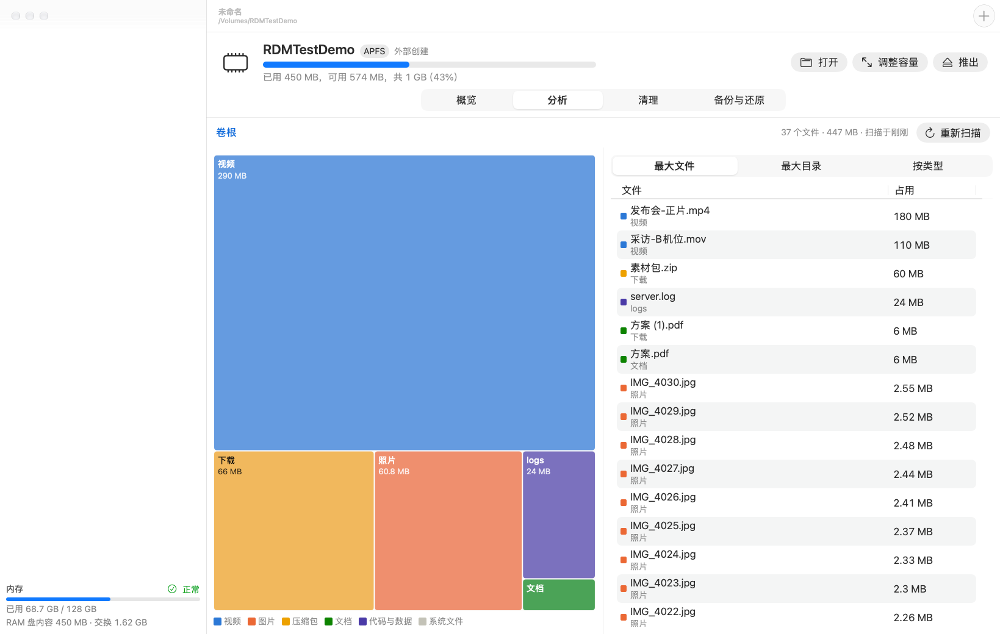

# RamDiskMgt

macOS 本机 RAM 盘管理工具：创建与管理、在线扩容/缩容、加密备份（整盘或部分）、磁盘分析、大文件与重复文件清理、从备份重建。SwiftUI 主窗口 + 菜单栏，另带命令行工具 `rdmctl`。

系统要求：macOS 27（依赖 `diskutil image`）。



## 构建

```bash
brew install xcodegen   # 如未安装
./scripts/build.sh
```

产物：

- `build/RamDiskMgt.app`：ad-hoc 签名，本机直接运行
- `build/rdmctl`：命令行工具

长期使用建议用固定证书签名并放进“应用程序”文件夹：`RDM_SIGN_IDENTITY="Apple Development: …" ./scripts/build.sh`。ad-hoc 签名每次构建都不同，钥匙串会在每次重新构建后再次询问是否允许读取备份密码，登录项也会失效。

`RamDiskMgt.xcodeproj` 由 xcodegen 根据 `project.yml` 生成，不在仓库里。想用 Xcode 打开，先运行一次 `xcodegen generate`。

## 功能

| 功能 | 说明 |
|---|---|
| 创建 | 四种类型：APFS、APFS（区分大小写）、HFS+、tmpfs。可选挂载位置，可设 nobrowse（Finder 隐藏）、noexec、关闭 Spotlight |
| 管理 | 列出本机所有 RAM 盘（包括其他工具创建的，可“纳入管理”）；显示容量和实际占用内存；系统内存压力；占用进程检查；推出（被占用时列出进程，可强制推出）；运行中修改 nobrowse / noexec / Spotlight（tmpfs 的 nobrowse / noexec 只保存到配置，重建时生效） |
| 扩容 / 在线扩容 / 缩容 | 热迁移：原盘照常使用时先全量同步，再增量同步，然后切换到新盘，核对一致后才释放旧盘，失败自动回滚。APFS 切换约 0.1 秒 |
| 加密备份 | 两种格式：AEA（AES-256 + LZFSE 压缩）和加密 DMG（Finder 可直接挂载）。整盘或勾选部分文件；密码可存钥匙串；支持定时自动备份、推出/退出时备份、只保留最近 N 份 |
| 还原 / 重建 | 还原整份或部分文件，可选“合并”或“替换”；推出后的盘以“已保存（未运行）”配置保留，一键按原配置重建并还原；可设应用启动时自动重建 |
| 分析 | treemap（可点击下钻）、按类型统计、最大文件、最大目录 |
| 清理 | 按大小、时间、类型、文件名通配筛选候选；查找重复文件（内容哈希）。会识别 APFS 克隆，按实际能释放的空间估算；删除前可先加密备份 |

## 使用要点

- **RAM 盘的内容推出或关机后就没了。** 重要内容请开启自动备份（盘的“概览 → 自动化”）。
- **tmpfs 的创建、推出、扩容都要输入管理员密码**，每次操作只弹一次。APFS 和 HFS+ 类型不需要密码。
- 内存按写入量分配：2GB 的盘只写了 100MB，就只占约 100MB 内存。
- 删除文件后，APFS 和 HFS+ 会立即归还内存；tmpfs 要延迟几分钟才回收。
- 备份密码至少 8 位。忘记密码就无法还原。
- **字体大小**：默认是放大 1.3 倍的“大”字号。可以在“设置”里换成标准、较大、大、特大、超大，或拖动滑块；任意窗口里也能用 ⌘+ 放大、⌘- 缩小、⌘0 恢复默认。

## 命令行

```bash
build/rdmctl list
```

```bash
build/rdmctl create --name Cache --size 4G --backend apfs
```

```bash
build/rdmctl resize /Volumes/Cache --size 8G
```

```bash
RDM_PASSWORD='你的密码' build/rdmctl backup /Volumes/Cache --format aea --paths 'proj,logs'
```

```bash
build/rdmctl analyze /Volumes/Cache --top 20
```

```bash
build/rdmctl clean /Volumes/Cache --min-size 200M
```

`rdmctl` 不带参数会显示全部命令。密码只从环境变量 `RDM_PASSWORD` 或交互输入读取，不走命令行参数。`clean` 默认只列出候选文件，加 `--yes` 才真正删除。

## 数据位置

| 内容 | 路径 |
|---|---|
| 磁盘配置、备份清单 | `~/Library/Application Support/RamDiskMgt/` |
| 默认备份目录 | `~/Library/Application Support/RamDiskMgt/Backups/`（每块盘可单独设置） |
| 诊断日志 | `~/Library/Application Support/RamDiskMgt/logs/`（`operations.log` 记录每次操作失败的错误原文；设置 → 诊断日志可直接打开） |
| 备份密码 | 登录钥匙串，服务名 `RamDiskMgt`：每块盘一条（`profile:<id>`），勾选保存的每份备份再各存一条（`backup:<id>`），删除备份时一并删除 |

设置环境变量 `RDM_SUPPORT_DIR` 可以把上面这些换到别的目录，测试时就是这么做的。

tmpfs 相关的管理员命令在后台线程上执行，界面不会被卡住；排查问题时可设 `RDM_APPLESCRIPT_MAIN_THREAD=1` 改回在主线程执行。

## 开发与测试

```bash
cd Packages/RamDiskKit && swift test
```

```bash
cd Packages/RamDiskKit && RDM_INTEGRATION=1 swift test
```

```bash
RDM_SUPPORT_DIR=/tmp/rdm-selftest build/RamDiskMgt.app/Contents/MacOS/RamDiskMgt --selftest apfs
```

```bash
RDM_SUPPORT_DIR=/tmp/rdm-shots build/RamDiskMgt.app/Contents/MacOS/RamDiskMgt --snapshot /tmp/rdm-shots/png
```

- 第一条：单元测试。
- 第二条：集成测试，会创建并推出名为 `RDMTest*` 的真实 ram:// 盘。
- 第三条：GUI 层端到端自检；把 `apfs` 换成 `tmpfs` 会弹管理员密码框。
- 第四条：把主要界面渲染成 PNG。
- 第三、四条用到的诊断入口只在 Debug 构建里，Release 产物默认不带；要在 Release 上跑就用 `RDM_DIAGNOSTICS=1 ./scripts/build.sh` 构建。

设计与实测结论见 [docs/设计文档.md](docs/设计文档.md)，测试记录见 [docs/测试报告.md](docs/测试报告.md)，代码审查结论见 [docs/代码审查-2026-11.md](docs/代码审查-2026-11.md)，审查改动的本地验证步骤见 [docs/本地测试指南.md](docs/本地测试指南.md)。

## 目录结构

```
App/                    SwiftUI 应用（AppModel、视图、自检与截图）
Packages/RamDiskKit/    核心库 + rdmctl + 测试
scripts/                构建脚本、图标生成
docs/                   设计文档、测试报告、截图
project.yml             xcodegen 工程描述
```

## 许可证

[Apache License 2.0](LICENSE)

Copyright 2026 3dnow
